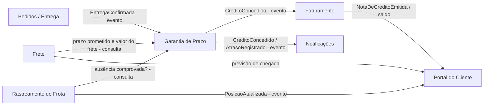

# 1. Modelagem do domínio

## Bounded contexts

| Contexto | Responsabilidade | Requisitos sob sua responsabilidade |
|---|---|---|
| **Garantia de Prazo** (novo) | Mede o atraso de cada entrega, aplica a regra do tipo de cliente e decide se há crédito e de quanto. Garante uma única apuração por entrega | RF01, RF02, RF03, RF04, RF09, RNF02 |
| **Rastreamento de Frota** (Telemetria) | Recebe as posições dos veículos e responde se uma ausência do destinatário está comprovada pela telemetria | RF05, RNF01 |
| **Faturamento** (C#) | Emite a nota de crédito com numeração sequencial e única e mantém o saldo de créditos do cliente | RF06, RNF03 |
| **Notificações** (Node/TS) | Entrega mensagens ao cliente pelo canal preferido, com retentativa e tratamento da falha final | RF07, RF08 |
| **Portal do Cliente** (React + BFF) | Mostra ao cliente posição, previsão de chegada e saldo de créditos com atualização ao vivo | RF10 |
| **Pedidos / Entrega** (Java) | Contexto fornecedor: registra a confirmação de entrega e o registro de ausência e publica esses fatos | — (fornece o evento `EntregaConfirmada`) |
| **Frete** (Python) | Contexto fornecedor: informa o prazo prometido e o valor do frete do pedido | — (fornece prazo e valor usados no RF01/RF02) |

RNF04 (contêineres) é transversal e fica com a infraestrutura, não com um contexto de negócio.

Decisão de fronteira: a Garantia **não** sabe calcular distância nem tempo parado do veículo. Ela pergunta ao Rastreamento "a ausência está comprovada?" e recebe um sim/não. Assim, RF05 tem um único dono e a Garantia continua falando só a língua de prazo e crédito.

## Mapa de contexto

Relações: Pedidos e Frete são **upstream** (fornecedores) da Garantia; a Garantia usa uma **camada anticorrupção** para traduzir o modelo de Pedidos/Frete para o seu (`Atraso`, `ValorFrete`, `TipoCliente`). Faturamento e Notificações são **downstream** e reagem a eventos publicados pela Garantia (linguagem publicada).

## Entidades e agregados

| Agregado | Raiz | Entidades e objetos de valor | Regra que protege |
|---|---|---|---|
| Apuração de Garantia (Garantia) | `ApuracaoGarantia` (id = id da confirmação de entrega) | VO `Atraso`, VO `ValorFrete` (Dinheiro), VO `TipoCliente`, VO `Credito`, VO `PrazoPrometido` | Uma única apuração por confirmação de entrega (RF09); crédito nunca maior que o teto do tipo de cliente (RF02/RF03) |
| Nota de Crédito (Faturamento) | `NotaDeCredito` | VO `NumeroNota`, VO `Dinheiro`, referência ao `CreditoId` | Número sequencial, nunca repetido (RF06/RNF03); no máximo uma nota por crédito |
| Notificação (Notificações) | `Notificacao` | Entidade `Tentativa`, VO `Canal` (EMAIL, WHATSAPP), VO `Destinatario` | No máximo 1 envio + 3 retentativas; falha final vai para a fila de falhas, nunca é descartada (RF08) |
| Viagem (Rastreamento) | `Viagem` | Entidade `Veiculo`, VO `Posicao` (lat, long, instante), VO `EnderecoEntrega` | Ausência comprovada só com veículo parado a ≤ 200 m do endereço por ≥ 10 min antes do registro (RF05) |

## Linguagem ubíqua

| Termo | Definição |
|---|---|
| Prazo prometido | Data e hora limite de entrega informada pelo serviço de Frete no momento do pedido |
| Confirmação de entrega | Registro, feito pelo motorista, de que o pedido foi entregue; tem um id único |
| Atraso | Diferença entre a confirmação de entrega e o prazo prometido, em horas. Entrega antes do prazo tem atraso zero |
| Tolerância | Atraso de até 2 h, inclusive, que não gera crédito |
| Faixa de atraso | Intervalo de atraso que define o percentual: (2 h, 24 h], (24 h, 72 h], acima de 72 h |
| Crédito | Valor devolvido ao cliente: percentual da faixa × valor do frete, limitado ao teto |
| Teto | Crédito máximo por pedido: R$ 500 (Varejo), R$ 2.000 (Corporativo) |
| Tipo de cliente | Varejo, Corporativo ou Cortesia; define percentuais e teto |
| Cortesia | Cliente com frete zero; nunca recebe crédito, mas é notificado do atraso |
| Ausência comprovada | Veículo parado a até 200 m do endereço por pelo menos 10 min antes do registro da ausência |
| Nota de crédito | Documento do Faturamento que formaliza o crédito, com número sequencial único |
| Canal preferido | Meio escolhido pelo cliente para ser avisado: e-mail ou WhatsApp |
| Falha final | Notificação que falhou no envio original e nas 3 retentativas |
