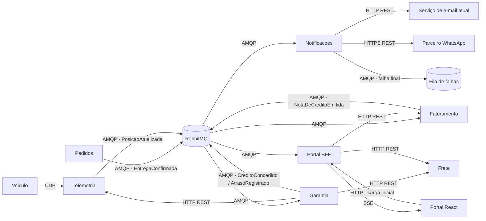

# 2. Arquitetura

## Diagrama dos serviços



## Protocolo de cada comunicação

| Origem | Destino | Protocolo | Requisito atendido | Justificativa |
|---|---|---|---|---|
| Veículo | Telemetria | UDP | RNF01 | Posição chega a cada 30 s e perder uma é aceitável: a próxima substitui. UDP não tem handshake nem retransmissão, o que é mais leve para milhares de veículos |
| Pedidos | Garantia (via RabbitMQ) | AMQP sobre TCP, fila durável, mensagem persistente, ack manual | RNF01, RNF02 | Confirmação de entrega **não** pode ser perdida. A fila durável guarda a mensagem mesmo com a Garantia fora do ar, e o ack manual só remove depois de processar. Assíncrono atende os 5 min com folga |
| Garantia | Frete | HTTP REST (GET) | RF01 | Consulta pontual e síncrona do prazo prometido e do valor do frete; a Garantia precisa da resposta para calcular |
| Garantia | Telemetria | HTTP REST (GET) | RF05 | Pergunta pontual "ausência comprovada para esta entrega?"; resposta sim/não necessária antes de decidir o crédito |
| Garantia | Faturamento (via RabbitMQ) | AMQP | RF06, RNF02 | Evento `CreditoConcedido` desacopla os serviços; se o Faturamento cair, a mensagem espera na fila e o crédito não se perde |
| Garantia | Notificações (via RabbitMQ) | AMQP | RF03, RF07 | Mesmo evento consumido por outro serviço (publish/subscribe); Cortesia gera `AtrasoRegistrado` só para notificar |
| Notificações | Serviço de e-mail | HTTP REST | RF07 | Integração já existente |
| Notificações | Parceiro WhatsApp | HTTPS REST | RF07 | API externa do parceiro; HTTPS por trafegar dados do cliente na internet |
| Notificações | Fila de falhas (DLQ) | AMQP | RF08 | A falha final é publicada numa dead-letter queue para reprocesso/alerta, não é descartada |
| Telemetria | Portal BFF (via RabbitMQ) | AMQP | RF10 | Posição publicada como evento; o BFF repassa ao navegador |
| Faturamento | Portal BFF (via RabbitMQ) | AMQP | RF10 | Nota emitida altera o saldo; o BFF empurra o novo saldo |
| Portal BFF | Frete / Faturamento | HTTP REST | RF10 | Carga inicial da previsão de chegada e do saldo |
| Navegador | Portal BFF | HTTP | RF10 | Primeira carga da tela |
| Portal BFF | Navegador | SSE | RF10 | Atualização ao vivo só no sentido servidor → cliente; SSE roda sobre HTTP, reconecta sozinho e é mais simples que WebSocket, que seria bidirecional sem necessidade |

## Padrões de projeto

| Ponto da solução | Padrão | Requisito | Justificativa |
|---|---|---|---|
| Regra de crédito por tipo de cliente | **Strategy** (`RegraCliente` com uma implementação por tipo) + registro de regras | RF02, RF03, RF04 | Cada tipo tem sua regra isolada. Um tipo novo é uma nova classe registrada, sem alterar Varejo/Corporativo/Cortesia (aberto/fechado) |
| Envio pelo WhatsApp | **Adapter** | RF07 | A API do parceiro tem formato diferente; o adapter implementa a mesma interface `CanalNotificacao` do e-mail, e o resto do serviço não conhece o parceiro |
| Escolha do canal | **Strategy** (via interface `CanalNotificacao`) | RF07 | O canal preferido do cliente escolhe a implementação em tempo de execução |
| Falha de envio | **Retry** com backoff + **Dead Letter Queue** | RF08 | Até 3 retentativas; esgotadas, a mensagem vai para a DLQ e gera alerta, nunca some |
| Consumo de `EntregaConfirmada` | **Idempotent Consumer** | RF09 | A mesma confirmação processada duas vezes produz um único crédito (detalhe abaixo) |
| Publicação de eventos da Garantia | **Transactional Outbox** | RNF01, RF09 | O crédito e o evento são gravados na mesma transação; um publicador lê a outbox e envia ao broker. Evita gravar crédito e perder o evento (ou o contrário) |
| Integração com Pedidos e Frete | **Anticorruption Layer** | RF01 | Traduz os modelos dos serviços existentes para a linguagem da Garantia |
| Atualização ao vivo | **Observer / Publish-Subscribe** | RF10 | O BFF assina eventos de posição e saldo e notifica os navegadores conectados |

### Ponto onde a dupla decidiu não aplicar padrão

**Faixas de atraso (RF02):** parecia caber um *Chain of Responsibility* (um elo por faixa) ou uma Strategy por faixa. Optamos por **não** aplicar: as faixas são **dados**, não comportamento diferente — todas fazem "percentual × frete". Ficaram numa tabela ordenada `(limite, percentual)` percorrida por uma função simples. Mudar uma faixa é mudar um valor, não criar classe. O padrão só aumentaria o número de classes sem ganho.

**Gerador de número da nota (RF06):** um *Singleton* em memória parecia natural para "um contador único". Não aplicamos porque com várias réplicas do Faturamento cada uma teria o seu Singleton e os números repetiriam. A garantia fica no banco (abaixo).

## Confirmação de entrega duplicada (RF09)

A garantia fica no serviço **Garantia de Prazo**, no banco dele, usando o **id da confirmação de entrega** como chave de idempotência:

1. A tabela `apuracao_garantia` tem `confirmacao_id` com restrição `UNIQUE`.
2. Ao receber `EntregaConfirmada`, o consumidor abre uma transação e faz `INSERT` da apuração + `INSERT` do evento na outbox.
3. Se a confirmação já foi processada, o `INSERT` viola a `UNIQUE`; a transação é desfeita, o consumidor dá **ack** na mensagem e não gera nada (é duplicata).
4. Segunda barreira no Faturamento: a nota tem `credito_id UNIQUE`, então mesmo um `CreditoConcedido` reentregue pelo broker não gera segunda nota.

Usar a restrição do banco (e não um "SELECT antes de inserir") evita a corrida em que duas cópias da mensagem são consumidas ao mesmo tempo por duas réplicas.

## Numeração das notas de crédito (RF06 e RNF03)

No Faturamento (PostgreSQL), dentro da mesma transação que grava a nota:

```sql
UPDATE sequencia_nota_credito
   SET ultimo_numero = ultimo_numero + 1
 WHERE id = 1
RETURNING ultimo_numero;

INSERT INTO nota_credito (numero, credito_id, valor, ...) VALUES (:numero, ...);
```

- O `UPDATE` trava a linha da sequência; transações concorrentes esperam a vez, então cada uma recebe um número diferente e **sem buracos** (se a transação falhar, o incremento é desfeito junto).
- `nota_credito.numero` tem `UNIQUE` como segunda barreira.
- Alternativa considerada: `SEQUENCE` do PostgreSQL — é atômica e mais rápida, mas pode deixar buracos em rollback. Como o requisito pede "sequencial", ficamos com a linha travada. O volume de notas (uma por entrega atrasada) não torna esse lock um gargalo.
- RNF03 é verificado por teste de integração com 1.000 emissões concorrentes (CT14).

## Execução em contêineres (RNF04)

Tudo sobe com `docker compose up`.

```yaml
services:
  rabbitmq:
    image: rabbitmq:3-management
    ports: ["5672:5672", "15672:15672"]

  postgres:
    image: postgres:16
    environment:
      POSTGRES_PASSWORD: logitech
    ports: ["5432:5432"]
    volumes: ["pgdata:/var/lib/postgresql/data"]

  telemetria:
    build: ./telemetria
    ports: ["9000:9000/udp", "8081:8080"]
    depends_on: [rabbitmq, postgres]

  pedidos:
    build: ./pedidos          # Java
    ports: ["8082:8080"]
    depends_on: [rabbitmq, postgres]

  frete:
    build: ./frete            # Python
    ports: ["8083:8080"]
    depends_on: [postgres]

  garantia:
    build: ./garantia         # novo serviço
    ports: ["8084:8080"]
    depends_on: [rabbitmq, postgres, frete, telemetria]

  faturamento:
    build: ./faturamento      # C#
    ports: ["8085:8080"]
    depends_on: [rabbitmq, postgres]

  notificacoes:
    build: ./notificacoes     # Node/TypeScript
    ports: ["8086:8080"]
    environment:
      WHATSAPP_API_URL: https://api.parceiro-whatsapp.example
    depends_on: [rabbitmq]

  portal-bff:
    build: ./portal-bff
    ports: ["8087:8080"]
    depends_on: [rabbitmq, frete, faturamento]

  portal-web:
    build: ./portal-web       # React
    ports: ["3000:80"]
    depends_on: [portal-bff]

volumes:
  pgdata:
```
